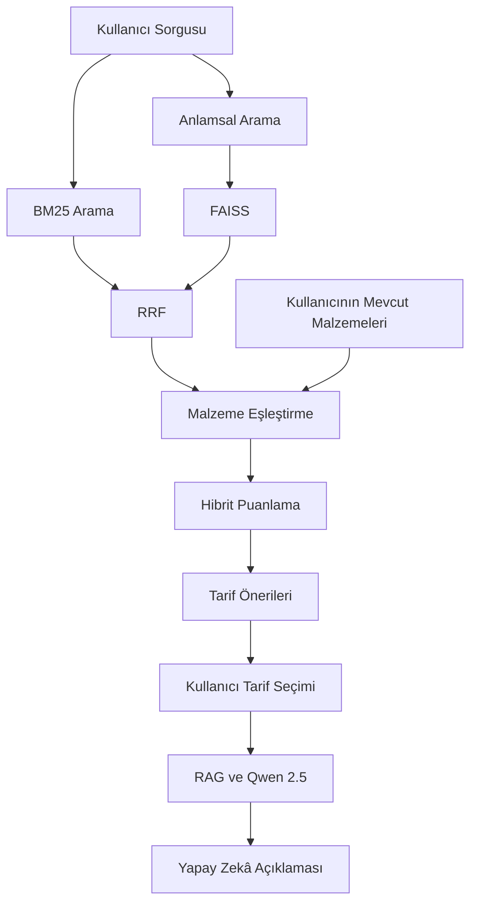

# 🌿 RecipeMind AI

### İyi yemek. Akıllı seçimler. Daha az israf.

RecipeMind AI, kullanıcıların evlerinde bulunan malzemelere ve kişisel tercihlerine uygun yemek tariflerini bulmalarını sağlayan yapay zekâ destekli bir bilgi erişim sistemidir.

## 🎯 Projenin Amacı

Geleneksel yemek tarifi arama sistemlerinden farklı olarak RecipeMind AI, yalnızca anahtar kelimelere değil, kullanıcının doğal dilde ifade ettiği tercihlere ve mevcut malzemelerine de odaklanmaktadır.

Projenin temel amaçları:

- Kullanıcıya uygun yemek tarifleri önermek.
- Mevcut malzemelerin değerlendirilmesini sağlamak.
- Eksik malzemeleri belirlemek.
- Yemek seçme sürecini kolaylaştırmak.
- Gıda israfının azaltılmasına katkı sağlamak.
- Farklı bilgi erişim algoritmalarını karşılaştırmak.

## 📚 Proje Kategorisi

Anlamsal Arama ve Bağlantı Analizi

## ✨ Proje Özellikleri

- Doğal dilde yemek tarifi arama
- 10.499 tariflik Türkçe veri seti
- Anahtar kelime tabanlı arama
- Anlamsal arama
- FAISS ile vektör benzerlik araması
- Reciprocal Rank Fusion (RRF)
- Hibrit arama algoritması
- Malzeme uyum oranı hesaplama
- Eksik malzemeleri belirleme
- Kategoriye göre filtreleme
- Hazırlama süresine göre filtreleme
- Tarifleri farklı kriterlere göre sıralama
- Favorilere tarif ekleme
- Alışveriş listesi oluşturma
- Alışveriş listesini indirme
- RAG tabanlı yapay zekâ asistanı
- Top-5 ve Top-10 performans değerlendirmesi
- Etkileşimli performans grafikleri
- Kullanıcı dostu ve görsel web arayüzü

## 🛠️ Kullanılan Teknolojiler

| Teknoloji | Kullanım Amacı |
|---|---|
| Python | Proje geliştirme |
| Pandas | Veri analizi |
| NumPy | Sayısal işlemler |
| BM25 | Anahtar kelime tabanlı arama |
| Sentence-Transformers | Anlamsal metin temsili |
| FAISS | Vektör benzerlik araması |
| RRF | Arama sonuçlarının birleştirilmesi |
| PyTorch | Model ve vektör işlemleri |
| Transformers | Dil modeli entegrasyonu |
| Qwen 2.5 1.5B Instruct | Yapay zekâ açıklamaları |
| RAG | Tarif verilerine dayalı açıklama üretimi |
| Streamlit | Web uygulaması |
| Altair | Performans grafikleri |
| Pillow | Görsel işleme |
| Hugging Face Hub | Veri ve model indirme |
| Git ve GitHub | Sürüm kontrolü |

## 📊 Veri Seti

Projede Hugging Face platformunda bulunan Turkish Recipes 175K veri setinin test bölümü kullanılmıştır.

- Kullanılan tarif sayısı: 10.499
- Veri formatı: JSONL
- Veri dili: Türkçe
- Vektör boyutu: 384

Veri setinde bulunan başlıca bilgiler:

- Tarif adı
- Tarif açıklaması
- Malzemeler
- Hazırlama talimatları
- Yemek kategorisi
- Hazırlama süresi
- Pişirme süresi
- Porsiyon bilgisi

### Veri Seti Kaynağı

https://huggingface.co/datasets/mmkocak/turkish-recipes-175K

### Kullanılan Anlamsal Arama Modeli

https://huggingface.co/sentence-transformers/paraphrase-multilingual-MiniLM-L12-v2

### Kullanılan Büyük Dil Modeli

https://huggingface.co/Qwen/Qwen2.5-1.5B-Instruct

## 🧠 Sistem Mimarisi



## 🔍 Hibrit Arama Algoritması

RecipeMind Hybrid algoritması, BM25 ve anlamsal arama sonuçlarını RRF yöntemiyle birleştirmektedir.

Her iki arama yönteminden en fazla 100 aday tarif alınmaktadır. Elde edilen sonuçlar RRF yöntemiyle birleştirilmekte ve kullanıcının mevcut malzemelerine göre yeniden sıralanmaktadır.

### Reciprocal Rank Fusion (RRF)

RRF, farklı arama algoritmalarının sonuç sıralamalarını ortak bir puanlama sistemi üzerinden birleştirmektedir.

RRF sabiti: k = 60

### Nihai Puanlama Formülü

```
Final Score = 0.60 × Normalized RRF Score
            + 0.40 × Ingredient Match Score
```

Algoritma ağırlıkları:

- RRF puanı: %60
- Malzeme uyumu: %40

Bu değerler algoritma ağırlıklarıdır; doğruluk veya başarı oranı değildir.

### Malzeme Uyum Oranı

```
Malzeme Uyumu = Eşleşen Malzeme Satırı Sayısı
                / Toplam Malzeme Satırı Sayısı
```

Kullanıcının girdiği malzemeler tarifte bulunan malzemelerle karşılaştırılır. Mevcut ve eksik malzemeler ayrı ayrı belirlenir.

Bu yöntem metinsel eşleşmeye dayanmaktadır; malzeme miktarlarının yeterliliğini garanti etmez.

## 🤖 RAG Yapay Zekâ Asistanı

Retrieval-Augmented Generation (RAG), bilgi erişimi ve doğal dil üretimini birleştiren bir yaklaşımdır.

RecipeMind AI, arama sonucunda getirilen tarif bilgilerini Qwen 2.5 1.5B Instruct modeline bağlam olarak aktarır.

Yapay zekâ asistanı:

- Tarifin neden önerildiğini açıklamaya çalışır.
- Kullanıcının tercihlerini dikkate alır.
- Mevcut malzemelerden yararlanır.
- Eksik malzemeleri dikkate alır.
- Tarif bilgilerine dayalı açıklama üretir.

Dil modeli yerel olarak çalışmaktadır. Harici bir ücretli yapay zekâ API anahtarı gerektirmemektedir.

Üretilen açıklamalar hatalı veya eksik bilgiler içerebilir. Tarifin orijinal bilgileri esas alınmalıdır.

## 📈 Akademik Performans Değerlendirmesi

Proje kapsamında dört farklı bilgi erişim yöntemi 10 test sorgusu üzerinden karşılaştırılmıştır.

### Deney Tasarımı

- Veri seti: 10.499 tarif
- Test sorgusu sayısı: 10
- Karşılaştırılan algoritma sayısı: 4
- Değerlendirme derinliği: Top-5 ve Top-10
- Top-5 deneyindeki sonuç kaydı: 200
- Top-10 deneyindeki sonuç kaydı: 400
- İlgililik ölçeği: 0, 1 ve 2

İlgililik puanları:

- 0: İlgisiz
- 1: Kısmen ilgili
- 2: Doğrudan ilgili

Precision, Recall ve F1 hesaplamalarında 1 ve 2 puanlı tarifler ilgili kabul edilmiştir.

nDCG hesaplamasında dereceli ilgililik puanları kullanılmıştır.

İlgililik etiketleri yapay zekâ destekli olarak oluşturulmuştur.

### Karşılaştırılan Algoritmalar

1. BM25
2. Semantic Search
3. Reciprocal Rank Fusion (RRF)
4. RecipeMind Hybrid

### Performans Sonuçları

| Metrik | BM25 | Semantic Search | RRF | RecipeMind Hybrid |
|---|---:|---:|---:|---:|
| Precision@5 | %84 | %62 | %82 | %78 |
| Recall@5 (Havuz) | %47.05 | %26.56 | %37.62 | %36.08 |
| F1@5 | %56.99 | %36.93 | %50.96 | %48.71 |
| nDCG@5 | 0.8175 | 0.4645 | 0.6767 | 0.7241 |
| nDCG@10 | 0.7603 | 0.4892 | 0.6689 | 0.7528 |
| Malzeme Uyumu | %23.18 | %16.80 | %25.10 | **%39.24** |
| Arama Süresi | 10.08 ms | 21.48 ms | 31.64 ms | 35.10 ms |

Malzeme uyumu ve arama süresi değerleri Top-5 deneyine aittir.

### Kullanılan Performans Metrikleri

- **Precision@5:** İlk beş sonuç içerisindeki ilgili tariflerin oranı.
- **Recall@5:** Değerlendirme havuzundaki ilgili tariflerin ne kadarının getirildiği.
- **F1@5:** Precision ve Recall değerlerinin harmonik ortalaması.
- **nDCG@5:** İlk beş sonucun ilgililik derecesini ve sıralama kalitesini ölçen metrik.
- **nDCG@10:** İlk on sonucun ilgililik derecesini ve sıralama kalitesini ölçen metrik.
- **Malzeme uyumu:** Kullanıcının mevcut malzemeleri ile tarif malzeme satırlarının eşleşme oranı.
- **Arama süresi:** Arama işleminin milisaniye cinsinden ölçülen süresi.

## 🏆 Deneysel Bulgular

RecipeMind Hybrid, dört yöntem arasında en yüksek ortalama malzeme uyumu oranını elde etmiştir.

### RecipeMind Hybrid Sonuçları

- BM25'e göre malzeme uyumunda %69.3 göreceli artış.
- RRF'ye göre malzeme uyumunda %56.3 göreceli artış.
- Precision@5 değeri: %78.
- Recall@5 değeri: %36.08.
- F1@5 değeri: %48.71.
- nDCG@5 değeri: 0.7241.
- nDCG@10 değeri: 0.7528.
- Ortalama malzeme uyumu: %39.24.
- Ortalama arama süresi: 35.10 ms.

### Top-10 Değerlendirmesi

BM25 algoritması 0.7603 nDCG@10 değeriyle en yüksek sonucu elde etmiştir.

RecipeMind Hybrid algoritması 0.7528 nDCG@10 değeriyle ikinci sırada yer almış ve BM25'e yakın bir sonuç elde etmiştir.

Geliştirilen hibrit algoritma, nDCG@10 metriğinde RRF ve Semantic Search yöntemlerinden daha başarılı olmuştur.

BM25 genel ilgililik metriklerinde daha başarılı olurken RecipeMind Hybrid, mevcut malzemelere uygun tariflerin önceliklendirilmesinde daha yüksek performans göstermiştir.

Elde edilen sonuçlar, geliştirilen hibrit yaklaşımın malzeme odaklı tarif önerme amacını desteklemektedir.

## 📱 Uygulama Bölümleri

### 1. Tarif Keşfet

Kullanıcının mevcut malzemelerine ve yemek tercihlerine göre kişiselleştirilmiş tarif önerileri sunar.

- Doğal dilde arama
- Malzeme uyumu
- Eksik malzemeler
- Kategori filtreleme
- Hazırlama süresi filtreleme
- Tarif sıralama
- Yapay zekâ açıklamaları

### 2. Favorilerim

Beğenilen tariflerin mevcut oturum içerisinde kaydedilmesini sağlar.

### 3. Alışveriş Listem

Eksik malzemelerden alışveriş listesi oluşturulmasını ve listenin metin dosyası olarak indirilmesini sağlar.

### 4. Sistem Analizi

Sistemin teknik ve akademik özelliklerini kullanıcıya sunmaktadır.

- Sistem mimarisi
- Kullanılan teknolojiler
- Algoritma ağırlıkları
- Veri seti bilgileri
- Performans karşılaştırma tablosu
- Precision@5 grafiği
- Recall@5 grafiği
- F1-Score grafiği
- nDCG@5 grafiği
- nDCG@10 grafiği
- Malzeme uyumu grafiği
- Arama süresi grafiği
- Deneysel bulgular ve sınırlamalar

## 📁 Proje Dosyaları

| Dosya | Açıklama |
|---|---|
| app.py | Temel tarif arama sistemi |
| semantic_search.py | Anlamsal arama |
| hybrid_search.py | Hibrit arama deneyleri |
| rrf_search.py | RRF algoritması |
| faiss_search.py | Vektör tabanlı arama |
| ingredient_match.py | Malzeme eşleştirme |
| search_engine.py | Ana arama motoru |
| rag_search.py | RAG yapay zekâ asistanı |
| premium_app.py | Ana web uygulaması |
| evaluation.py | Top-5 algoritma testleri |
| evaluation_metrics.py | Top-5 performans hesaplamaları |
| evaluation_top10.py | Top-10 algoritma testleri |
| evaluation_top10_metrics.py | nDCG@10 hesaplamaları |
| relevance_labels.json | Top-5 ilgililik etiketleri |
| relevance_top10_labels.json | Top-10 ilgililik etiketleri |
| performance_metrics.json | Top-5 performans sonuçları |
| performance_top10_metrics.json | nDCG@10 performans sonuçları |
| performance_dashboard.py | Akademik analiz paneli |
| setup_data.py | Otomatik veri ve model hazırlama |
| requirements.txt | Gerekli Python kütüphaneleri |
| assets/ | Uygulama görselleri |
| README.md | Proje dokümantasyonu |
| .gitignore | Git dışında bırakılan dosyalar |

## ⚙️ Kurulum

### 1. Projeyi Bilgisayarınıza İndirin

```bash
git clone https://github.com/isilkktn/RecipeMind-AI.git
```

### 2. Proje Klasörüne Giriş Yapın

```bash
cd RecipeMind-AI
```

### 3. Gerekli Kütüphaneleri Yükleyin

```bash
python -m pip install -r requirements.txt
```

### 4. Veri Seti ve Yapay Zekâ Modellerini Hazırlayın

Gerekli veri setini, tarif vektörlerini ve yapay zekâ modellerini otomatik olarak hazırlamak için:

```bash
python setup_data.py
```

Kurulum dosyası aşağıdaki işlemleri gerçekleştirmek üzere hazırlanmıştır:

- Gerekli veri klasörünü oluşturur.
- Türkçe yemek tarifi veri setini indirir.
- Sentence-Transformers modelini hazırlar.
- Tariflerin anlamsal vektörlerini oluşturur.
- Qwen 2.5 yapay zekâ modelini hazırlar.

İlk kurulumda internet bağlantısı gereklidir. Kurulum süresi bilgisayarın donanımına ve internet bağlantısına göre değişebilir.

Veri seti ve vektör dosyaları GitHub deposuna dahil edilmemiştir.

Veri setinin kullanım koşulları Hugging Face üzerindeki kaynak sayfasından kontrol edilmelidir.

Otomatik kurulum mevcut geliştirme ortamında başarıyla çalıştırılmıştır. Farklı bir bilgisayarda sıfırdan kurulum henüz doğrulanmamıştır.

## 🚀 Uygulamayı Çalıştırma

Gerekli veri ve model dosyaları hazırlandıktan sonra aşağıdaki komutu çalıştırın:

```bash
python -m streamlit run premium_app.py --theme.base light --theme.primaryColor "#38583F" --theme.backgroundColor "#FAF8F3" --theme.textColor "#283C30"
```

Tarayıcı üzerinden uygulamaya erişilebilir:

http://localhost:8501

## 🧪 Performans Testlerini Çalıştırma

### Top-5 Arama Testleri

```bash
python evaluation.py
```

### Top-5 Performans Metriklerini Hesaplama

```bash
python evaluation_metrics.py
```

### Top-10 Arama Testleri

```bash
python evaluation_top10.py
```

### nDCG@10 Metriğini Hesaplama

```bash
python evaluation_top10_metrics.py
```

Performans hesaplamalarında mevcut ilgililik etiketleri kullanılmaktadır. Veri seti veya arama sonuçları değişirse ilgililik etiketlerinin yeniden kontrol edilmesi gerekir.

### Akademik Performans Panelini Bağımsız Çalıştırma

```bash
python -m streamlit run performance_dashboard.py
```

## ⚠️ Deneysel Sınırlamalar

- Performans değerlendirmesi 10 test sorgusuyla sınırlıdır.
- İlgililik etiketleri yapay zekâ destekli oluşturulmuştur.
- Bağımsız insan değerlendirmesi yapılmamıştır.
- Recall değerleri bütün veri setine değil, değerlendirme havuzuna göre hesaplanmıştır.
- nDCG için ideal sıralama değerlendirme havuzuna dayanmaktadır.
- Eş anlamlı ve doğrudan kelime eşleşmesi olmayan sorgular için ayrı bir deney henüz gerçekleştirilmemiştir.
- Malzeme uyumu metinsel eşleşmeye dayanmaktadır.
- Malzeme miktarlarının yeterliliği garanti edilmemektedir.
- Malzeme eş anlamlılarının tanınması sınırlıdır.
- Tarif görselleri temsili kategori görselleridir.
- Favoriler ve alışveriş listesi mevcut kullanıcı oturumu içerisinde saklanmaktadır.
- Filtreleme işlemleri arama motorunun getirdiği aday tarifler üzerinde uygulanmaktadır.
- Yapay zekâ açıklamalarında hatalı bilgiler oluşabilmektedir.
- Arama süreleri model yükleme ve RAG yanıt üretim sürelerini kapsamamaktadır.
- Arama süreleri kullanılan bilgisayarın donanımına göre değişebilir.
- Gıda israfındaki gerçek azalma deneysel olarak ölçülmemiştir.

## 🔮 Gelecekte Yapılabilecek Geliştirmeler

- Daha geniş kapsamlı performans değerlendirmesi
- Eş anlamlı sorguların ayrı olarak değerlendirilmesi
- Bağımsız kullanıcı değerlendirmesi
- Malzeme eş anlamlılarının tanınması
- Besin değeri ve kalori hesaplama
- Malzeme miktarlarının analiz edilmesi
- Kullanıcı hesabı ve kalıcı favoriler
- Kişiselleştirilmiş beslenme önerileri
- Mobil uygulama entegrasyonu
- Gelişmiş Türkçe dil modeli kullanımı
- Bulut ortamında yayınlama

## 📌 Proje Durumu

Temel sistem geliştirmesi tamamlanmıştır.

- [x] Veri seti hazırlama
- [x] Anahtar kelime tabanlı arama
- [x] Anlamsal arama
- [x] FAISS entegrasyonu
- [x] RRF algoritması
- [x] Hibrit arama algoritması
- [x] Malzeme uyumu hesaplama
- [x] RAG entegrasyonu
- [x] Web arayüzü
- [x] Favoriler ve alışveriş listesi
- [x] Top-5 akademik performans değerlendirmesi
- [x] nDCG@10 değerlendirmesi
- [x] Performans grafikleri
- [x] Otomatik kurulum dosyası
- [x] Proje dokümantasyonu
- [ ] Eş anlamlı sorgulara özel değerlendirme
- [ ] Bağımsız insan değerlendirmesi
- [ ] Farklı bilgisayarda kurulum doğrulaması

## 🎓 Akademik Bilgiler

- Üniversite: İstinye Üniversitesi
- Bölüm: Yazılım Mühendisliği
- Ders: Akıllı Bilgi Erişim Sistemleri ve Metin Analitiği
- Proje Türü: Bireysel Proje
- Proje Kategorisi: Anlamsal Arama ve Bağlantı Analizi
- Geliştirici: Ferda Işıl Kökten
- Numara: 2609111042

---

🌿 RecipeMind AI | İyi yemek. Akıllı seçimler. Daha az israf.
